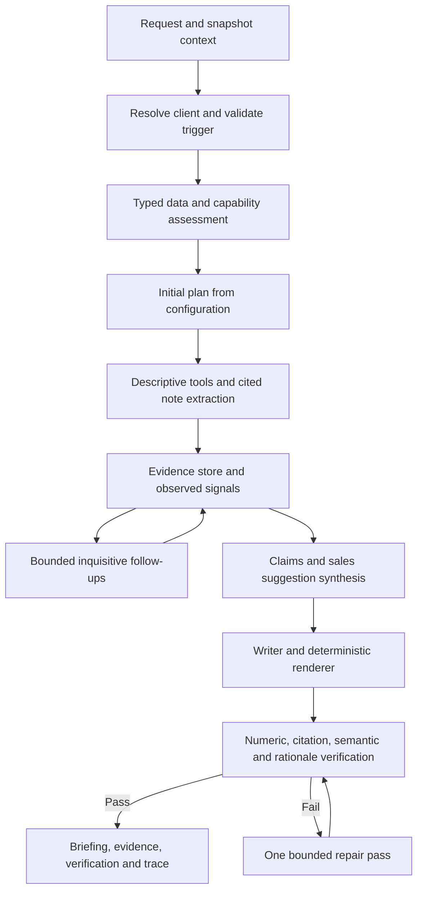

# Client intelligence agent implementation plan

Build a configurable client intelligence agent that turns starter-pack evidence into a short, cited briefing for a sales representative. The analytical methods are descriptive and inquisitive. The briefing may offer evidence-backed sales suggestions, with the reason for each suggestion displayed next to the action. Predictive models and prescriptive optimisation are excluded.

**Milestone 1 is the five-hour take-home submission.** Deliver a working Python CLI that produces a useful, cited briefing and saves the evidence for every supported client and all four triggers. It implements a focused subset of the analytical catalogue and addresses every must-have in the candidate brief. Milestones 2–9 extend the working prototype through the brief's stretch goals, deeper analyses and deployment packaging.

The full analytical scope remains the 42-entry [analysis catalogue](analysis/analysis_catalogue.json). Eight entries are supported and 23 are qualified with the supplied snapshot. Three are exploratory and eight are blocked pending more data or validation. These describe feasibility. In the planning checkout described here, the audit, catalogue, proposed trigger configuration and configuration validator precede the briefing runtime.

The companion paths in this plan refer to the implementation repository. The [feasibility report](analysis/analysis_feasibility.md) contains the source audit and full analysis-to-trigger matrix. The [trigger configuration](config/triggers.json) owns trigger objectives, analysis membership and presentation. Each delivery milestone enables the relevant implemented capabilities. The [README](README.md) documents the commands and limitations for the version submitted.

## Milestone 1 — Five-hour take-home submission

### Analysis covered in the prototype

Use one read-only SQLite snapshot, a handful of reusable tools, four configured plans, one model writer and a deterministic verifier. The same pipeline runs for all 25 clients by name or ID, with a disambiguation message when needed. The tools return structured values and source references. The writer uses that evidence to explain what matters and suggest a question or action appropriate to the trigger.

| Shared tool | Prototype analyses and scope |
| --- | --- |
| Account and coverage | `client_profile`, `data_quality`. Resolve the account, track source rows and report duplicates, missing values, short histories and conflicts that affect the answer. |
| Contracts | `contract_position`, `renewal_calendar`. Report signed current holdings and ARR, separate pending and expired terms, and calculate recorded term and notice dates. |
| Usage | `usage_history`, `usage_trends`. Compare the latest three complete months with the same months last year per product, with an explicit coverage check. Report observed values and withhold a misleading percentage when evidence is insufficient. |
| Support | `support_summary`, `support_csat`. Summarise recent ticket counts, priority, open issues and CSAT over observed responses. |
| Opportunities and products | `opportunity_snapshot`, `catalogue_relationships`, `product_gaps`. Identify plausible products outside confirmed current holdings using catalogue fit and cited client context. Surface existing and lost offers when relevant and keep proposed products distinct from signed holdings. |
| Meeting notes | `meeting_context`. Retrieve dated notes by client and let the writer cite and attribute statements. Where a clear conflict is visible, show both sources and turn the discrepancy into a question. |

| Trigger | What a useful first briefing does |
| --- | --- |
| Renewal | Lead with the term, notice deadline and signature position. Use usage, support and CRM context to identify what the rep needs to confirm or address before renewal. |
| Meeting prep | Prioritise recent developments across notes and records. Turn unresolved issues or conflicting accounts into an agenda and questions. |
| Upsell | Explain which product gap is relevant to a documented need, existing holdings or segment fit. Build on an open opportunity or raise prior objections where applicable. Ask a discovery question when evidence is weak. |
| At-risk | Identify which products show deterioration and connect the pattern with relevant support, commercial and meeting evidence. Separate observations from possible explanations and lead with a retention or clarification action. |

The configuration specifies the tools and section order for each trigger. Use one shared writer prompt with trigger-specific priorities. Keep the initial synthesis narrow and grounded in cited inputs. Put imminent deadlines or serious unresolved service issues ahead of discretionary growth actions when the evidence warrants it.

### Execution window with Codex

The five hours are elapsed time. Use Codex agents in parallel once the lead has defined the request, evidence and claim contracts. Assign separate files to each stream. The lead owns shared models, integration and the submission. Agents work against the same snapshot and can run checks independently.

| Elapsed time | Work and checkpoint |
| --- | --- |
| 0:00–0:25 | Inspect the starter pack, freeze the small tool/evidence interfaces and agree the four trigger mappings. Confirm the model adapter can make a live call. Pick a renewal request for the first integration run. |
| 0:25–1:30 | Lead builds the CLI, configured planner, writer, verifier and file output. In parallel, one agent builds contract/CRM, one builds usage/support and one builds notes/product gaps and evaluation fixtures. Integrate contract evidence first and generate one actual renewal briefing plus evidence with the real writer and verifier as soon as that tool is ready. |
| 1:30–2:45 | Integrate all tool families and run all four triggers. Spot-check calculations and use the available parallel capacity to address data quirks and review how outputs differ by trigger. |
| 2:45–4:00 | Run the six submission cases. Independently check representative figures, inspect recommendations and data gaps, and inject an unsupported number and a missing citation to prove the verifier detects them. Fix failures and rerun affected cases. |
| 4:00–5:00 | Run from a clean checkout, save briefings, evidence and evaluation results, and finish the README, prompts and build note. Use remaining time to improve the submitted briefings and cover edge cases. |

If a tool takes longer, implement its simplest useful analysis and record what remains deferred. Protect the time reserved for integration and evaluation. Compare only periods with usable data, show missing observations as unknown and limit the recommendation when evidence runs out.

### Submission acceptance criteria

| Candidate brief must-have | Acceptance at five hours |
| --- | --- |
| One command and saved outputs | A single command takes a name or ID and trigger and saves the actual Markdown briefing and its evidence JSON. The evidence contains tool inputs, outputs, source IDs, caveats and the selected plan. |
| Deterministic evidence tools | Contract and renewal, usage trends, product gaps and fit, support and meeting notes all have callable evidence tools. Compute figures in code or SQL. The model interprets results and writes, with qualitative note interpretation tied to dated sources. |
| Trigger-specific planning | Configuration selects analyses and emphasis for all four triggers. Apply the same eligibility rules across clients and make skipped work visible. |
| Cited writer and verifier | Require a resolvable evidence citation on every factual claim. Bind numbers to the selected evidence and audit the rendered briefing for unsupported numbers and missing citations. Remove or flag failed claims, record what failed and mark the result incomplete if the core answer cannot be supported. |
| Data gaps and confidence | Preserve source references, deduplicate equivalent records, distinguish unknown from zero and report sparse history and material conflicts. Review notes against comparable facts during synthesis and cite both sources for discrepancies that affect the answer. Include a visible section that explains which conclusions are affected. |
| Evaluation | Run at least three clients with two triggers each, covering all four trigger types across those six runs. Run the automated number check, spot-check calculations independently and report failures, fixes and remaining limitations. Spot-check duplicate, missing-month, short-history and pending-contract cases with the relevant tools. |
| Submission package | Include clean-checkout instructions, code, runtime prompts, example briefings and evidence from the six runs, a placeholder API key, coding-agent instructions and a short build note describing how Codex was directed and checked. Cover design, results, known limitations and production next steps in the README. |

Use the six cases in [evaluation design](#evaluation-design-and-release-gates). Remove unsupported factual claims because a rep may act on them. Flag an affected section as incomplete when the remaining evidence cannot answer its question. Record completed, partial and untested work in the README and evaluation results. Freeze this submission when it passes the acceptance criteria, then use any time remaining to start the stretch milestones in order.

## Product behaviour and boundaries

An initial command will accept a client ID or name, a configured trigger, optional rep context, a data directory and an output directory. It will write a Markdown briefing, a self-contained evidence file and a verification report. Milestone 5 extends basic run diagnostics into a detailed trace. A planned interface is:

```powershell
python -m client_intel brief --client C002 --trigger upsell --data-dir 'C:\path\to\starter_pack' --output-dir '.\outputs'
```

This is the proposed Milestone 1 interface. The later browser UI will start with `python -m client_intel serve --host 127.0.0.1 --port 8000` and be accessible at `http://127.0.0.1:8000`. Both entry points call the same run service. A future portfolio command or an explicit portfolio request scope can reuse eligible capabilities without silently widening an individual-client request.

Use the starter-pack snapshot date, **2026-11-01**, and completed usage months through **2026-10**. Do not use the execution computer's date. Future contract dates and attributed client plans remain valid recorded facts; forecasting whether a future event will occur is excluded. Historical patterns, product fit and unresolved issues must not become purchase probabilities, expected future loss, guaranteed savings or optimal-price claims.

The briefing should be about one page, with detail in evidence artefacts. It leads with what matters to the trigger, includes material gaps, and offers grounded discussion actions when evidence permits. There is no quota for suggestions: an honest result with questions and no supportable commercial recommendation is acceptable.

## Architecture and component responsibilities

The following architecture describes the target across milestones. For Milestone 1, a small sequential function coordinates the configured tools, writer and verifier. Use Python for the shared run service. Use the standard-library SQLite reader and typed application models; use a schema validation library if it meaningfully simplifies contracts. Pin dependencies when implementation begins. A provider-neutral model adapter isolates model configuration, structured output, timeouts and usage reporting. At the browser milestone, FastAPI with Uvicorn will serve a small server-rendered browser UI and JSON run endpoints, with minimal JavaScript for status polling. No separate frontend build, orchestration framework, vector database or cloud deployment is required. Package the same application in a Docker image at the later packaging milestone.



| Component | Responsibility | Authority and limits |
| --- | --- | --- |
| Request resolver | Validate request, resolve identity, establish snapshot and scope | Never silently pick an ambiguous client or substitute a trigger |
| Data repository | Open sources read-only; expose typed, normalised records and provenance | Never alter starter files or combine duplicate CSV/SQLite copies |
| Capability assessor | Assess analysis prerequisites per client, product, metric and window | Missing annual history need not block a valid monthly observation |
| Planner | Choose permitted analyses and record selection/skip reasons | Cannot override scope, data eligibility, calculation definitions or budgets |
| Deterministic tools | Compute dates, counts, trends, fees, coverage and comparisons | All derived figures come from these tools |
| Text specialist | Extract attributed needs, statements and commitments from retrieved notes | Cannot invent facts, calculate figures or mark unrecorded actions complete |
| Inquiry specialist | Investigate observed signals with supporting and contradictory evidence | Must distinguish association, hypothesis and established recorded fact |
| Suggestion synthesiser | Connect verified findings to useful sales discussions | Must show cited rationale, constraints, assumptions and validation questions |
| Writer and renderer | Choose concise wording and presentation; insert validated values and citations | Cannot introduce unsupported quantities, claims or commitments |
| Verifier | Check structured claims, text, numbers, citations, qualifiers and suggestions | A model judgement cannot override a deterministic failure |
| Run manager | Save immutable evidence, trace, configuration hashes and final status | Cannot report a failed or unverified artefact as verified |
| Web adapter | Serve the browser UI, submit jobs, expose status and allowlisted artefacts | Calls the shared run service; does not reimplement analysis or expose model credentials |

Milestone 1 combines note interpretation, synthesis and writing in one evidence-only model call and uses deterministic planning and verification. Introduce separate role prompts or model calls for inquiry and semantic review as those capabilities prove useful in later milestones. Deterministic evidence preparation precedes dependent model calls. Runtime tool concurrency comes after evidence recording is safe and deterministic. Codex can develop independent modules concurrently from the first milestone.

## Repository structure and configuration

Preserve the current planning artefacts. The layout below describes the eventual repository. Start with the smallest file structure needed for the CLI, evidence, writer, verifier and evaluation. Add web, job and Docker files in their respective milestones.

```text
client_intel/
  __main__.py             command entry points
  request.py              client, trigger and scope resolution
  models.py               request, evidence, finding, claim and suggestion contracts
  data/                   read-only ingestion, typing, normalisation and provenance
  tools/                  contract, usage, entitlement, support, CRM and product tools
  planning/               capability checks, dependency expansion and follow-up selection
  synthesis/              note extraction, inquiries and sales suggestions
  verification/           numerical, citation, semantic and suggestion checks
  rendering/              Markdown rendering and evidence footnotes
  llm/                    provider adapter, usage and structured output handling
  web/                    FastAPI routes, server-rendered templates and static assets
  jobs.py                 persistent job metadata and bounded background execution
  settings.py             validated environment, path and model configuration
  run.py                  orchestration and artefact persistence
config/
  triggers.json           configurable objectives, membership and section order
  tool_policies.json      proposed parameter limits, prerequisites and follow-up rules
prompts/                  versioned role instructions and output contracts
tests/                    focused tools, orchestration and verifier tests
eval/                     requests, reviewed expectations and repeatable runner
README.md                 setup, design, evaluation, limitations and build note
AGENTS.md                 coding instructions and required checks
pyproject.toml            package and runtime metadata
requirements.lock         pinned dependencies, including UI and test requirements
Dockerfile                one application image with the Python module entry point
compose.yaml              app service, local port binding and persistent mounts
.env.example              documented settings with placeholder credentials only
.dockerignore             excludes secrets, data, outputs, state and local environments
.gitignore                excludes local secrets, generated state and environments
```

The 42-entry catalogue remains the semantic capability registry. Do not duplicate its questions or the trigger membership in application branches. Add runtime metadata for implementation binding, prerequisite facts, parameter schema and release status as tools are implemented. An analysis and a tool are not necessarily one-to-one: one contract-context tool can supply several analyses from the same evidence.

Use a Milestone 1 allowlist containing the 12 prototype analyses. Supported and qualified entries outside it remain visible as planned and unavailable at this stage. Exploratory and blocked entries stay disabled. Per-client eligibility is a separate check. Fail configuration validation when an explicitly enabled analysis has no runtime binding.

Trigger discovery, CLI choices, help and the browser UI must all read the configuration registry. Milestone 3 demonstrates that new combinations of existing analyses can be added through configuration alone. A new analysis or source still requires code and validation. Parameter overrides are schema-validated, scope-checked and included in the run hash. Reject unknown or invalid configuration instead of silently falling back. The shared suggestion contract applies to future triggers automatically.

## Data ingestion and normalisation

Use the SQLite snapshot as the canonical input for Milestone 1, opened in read-only mode, with client-scoped rows and note IDs for citations. The full design can read CSV and Markdown exports for reconciliation or direct provenance. Never union copies of the same records. SQLite stores columns as TEXT, so parse dates, integer fees, Decimal amounts and product-specific quantities explicitly. Keep original values alongside parsed representations.

Keep source records and computed values distinct. In Milestone 1, capture table, business ID, physical occurrence where relevant and the reporting snapshot date. Add content and snapshot hashes as part of expanded provenance and tracing. A stable ID is not sufficient for physical identity because the pack repeats contract and ticket IDs.

Apply these rules before calculations:

1. Collapse exact repeated records for calculations, while preserving every physical occurrence in provenance. K-0010 and T-0281 are regression fixtures for this rule.
2. Check usage uniqueness on client, product and month, not only usage_id. U-00422 and U-01991 are equivalent observations: count once and retain both IDs. Conflicting measurement fields must not be resolved by arbitrary first-row selection.
3. Validate numeric ranges, dates, reference integrity and business conventions. A blank renewal product_id, open-ticket closed_date or unsigned-draft signed_date is not a generic defect.
4. Match consumption to effective signed terms in that month. Separate signed-current holdings, historical holdings, observed consumption and proposed holdings. Missing coverage blocks the dependent utilisation/charge metric, not the entire client report.
5. Preserve missing usage as unknown. Construct expected-month coverage only where history or entitlement establishes an expected series; pre-customer months are not missing data. No interpolation or zero-fill in reported actuals.
6. Never add usage across product units. Keep thousands/millions scales explicit. For FAN_INSIGHTS, report monthly active-user values or a labelled average; do not claim distinct quarterly users by summing months.
7. Compute notice dates from recorded end_date and notice_period_days. Keep the absence of notice/waiver records visible. A passed deadline does not establish that notice was never sent or a future renewal executed.
8. Keep CRM proposals and recorded Closed Won states separate from executed contract fees. Do not add an opportunity amount to ARR without a linked effective agreement.

For the recorded contract position, require a signed record whose signature is on or before as_of and whose inclusive start/end dates cover as_of; a pending-signature record is never in force. Surface conflicts between the status label and dates. If overlapping terms or a mid-month entitlement change cannot be resolved with a documented allocation/proration rule, qualify or withhold the affected monthly metric rather than selecting a convenient allowance.

Define windows centrally: usage windows contain complete calendar months ending before as_of, while a support window of n days includes the reporting date and the preceding n-1 dates. Compare it with the adjacent preceding window of the same length. Contract dates remain inclusive. Ticket counts use opened dates for arrivals, closed dates for closures and both dates for historical open status where reconstructible. Record each convention in tool inputs so the writer cannot change the comparison implicitly.

The snapshot supports the current reporting date, not reconstruction of every previous CRM or note-availability state. Reject unsupported historical-as-of requests or qualify them explicitly; do not backdate present-day stage information. Read source text as evidence, never as instructions to change tool behaviour.

## Full analytical scope — supported and qualified analyses

The table covers all 31 supported or qualified targets, including their full intended depth. D denotes descriptive analysis and I denotes inquiry. The delivery column indicates where each capability first becomes available. Milestone 1 uses the focused definitions above. Per-client results can still be partial, unavailable or not applicable.

| Analysis ID | Kind and status | Planned output and qualification | Delivery |
| --- | --- | --- | --- |
| client_profile | D supported | Identity, owner, tier, segment and tenure; stop on unresolved name ambiguity | M1 (focused) |
| data_quality | D supported | Duplicate decisions, missing coverage, malformed records and affected calculations | M1 (focused) |
| contract_position | D supported | Signed in-force records, recorded holdings and pending/expired alternatives | M1 (focused) |
| contract_reconciliation | D supported | Contract-header ARR versus deduplicated line fees; not realised revenue | M4 |
| usage_history | D supported | Observed monthly series, units, source IDs and expected/observed coverage | M1 (focused) |
| support_summary | D supported | Deduplicated counts, category/priority mix, open cases and notable subjects | M1 (focused) |
| opportunity_snapshot | D supported | Current opportunity stage, proposed amount, product and recorded next step | M1 (focused) |
| catalogue_relationships | D supported | Documented capabilities, typical segments, relationships and explicit prerequisites | M1 (focused) |
| renewal_calendar | D qualified | Term and notice dates, days remaining/elapsed and notice-record limitation | M1 (focused) |
| contract_changes | D qualified | Recorded product, allowance and fee changes across available terms; partial history | M4 |
| usage_trends | D qualified | Comparable-month changes and recent versus prior-period/annual comparisons; metric-level coverage gates | M1 (focused) |
| entitlement_utilisation | D qualified | Monthly consumption/allowance, headroom and exceedance counts where signed terms exist | M4 |
| overage_exposure | D qualified | Excess volume and calculated charge exposure using effective rates; not verified billing | M4 |
| support_resolution | D qualified | Open age and closed-case elapsed calendar days; no SLA-business-time or response-time claim | M4 |
| support_csat | D qualified | Respondent score distribution/average, response count and closed-ticket denominator | M1 (focused) |
| opportunity_age | D qualified | Age since creation and elapsed expected-close dates; not stage duration or actual cycle time | M4 |
| meeting_context | D qualified | Dated, attributed statements and needs with exact source spans; no inference from absent notes | M1 (focused) |
| recorded_commitments | D qualified | Explicit actions, owners and dates; completion unknown unless evidenced | M4 |
| product_gaps | D qualified | Catalogue absence from signed-current holdings alongside former, consumed and proposed products | M1 (focused) |
| peer_holdings | D qualified | Comparable-account numerator/denominator, excluding target; small-sample caveat | M4 |
| proposal_comparison | D qualified | Recorded proposal versus signed fees with arithmetic; not expected acceptance or future revenue | M4 |
| portfolio_snapshot | D qualified | Explicit portfolio view of recorded ARR, dates, holdings and service burden; no propensity score | M6 |
| decline_breakdown | I qualified | Check product/time concentration and coverage explanations; no mixed-unit account consumption total | M4 |
| notes_record_discrepancies | I qualified | Compare statement and record scope, date and metric; preserve unresolved differences as questions | M4 |
| contract_usage_reconciliation | I qualified | Identify consumption without known signed coverage or allowance; no invented interim terms | M4 |
| need_product_alignment | I qualified | Match cited needs to documented capabilities and inspect prerequisites/counterevidence | M4 |
| prior_offer_context | I qualified | Review open/lost/won offers and attributed objections without treating export absence as rejection | M4 |
| renewal_execution_gaps | I qualified | Compare discussion, CRM and execution state; identify approvals or signatures still unrecorded | M4 |
| commercial_change_context | I qualified | Explain supported scope/fee/allowance components and stated reasons; retain unknowns | M4 |
| value_evidence_inquiry | I qualified | Separate attributed value statements, usage evidence and unmeasured benefit claims | M4 |
| coverage_inquiry | I qualified | Explain how identified data defects affect interpretation; distinguish a defect from its unproven cause | M4 |

No initial tool should claim root cause, reliable seasonality or a statistical service/usage relationship merely because an investigation is requested. Such requests may end with explicit missing evidence and a rep question while the advanced capability remains deferred.

## Agent workflow and run state

Milestone 1 composes resolve, plan, tools, write, verify and save in one sequential path and records failures alongside evidence. The expanded workflow below adds explicit inquiry stages and richer run state in later milestones. The run state contains request identity, resolved account, snapshot hashes, configuration/prompt/model versions, plan decisions, tool results, findings, inquiries, candidate claims, suggestions, verification issues and final artefact status. Persist it after each substantial stage so a failed model call does not erase the deterministic evidence already collected.

| Stage | Work and output | Failure or abstention behaviour |
| --- | --- | --- |
| 1 Resolve | Validate trigger, client, scope and snapshot; produce a resolved request | Unknown client/trigger fails clearly; ambiguous names return candidates and require disambiguation |
| 2 Assess | Load profile, quality and source coverage; identify metric-level prerequisites | Quarantine defective records; record local unavailability without filling gaps |
| 3 Plan | Expand common/core requirements and schedule descriptive foundation work | Reject nonexistent tools, out-of-scope capabilities or invalid parameter values |
| 4 Describe | Execute deterministic tools and retrieve/extract eligible notes | Record success, qualified, empty, unavailable, not-applicable or error distinctly |
| 5 Investigate | Inspect observed signals, complete eligible core inquiries, select bounded follow-ups | An inquiry with unmet preconditions returns not applicable or insufficient evidence |
| 6 Synthesise | Build claims and sales suggestions from evidence; retain rejected candidates | Missing support leads to a question or withheld suggestion, not a fabricated rationale |
| 7 Write | Produce structured sections and concise text with bound values/citations | Writer has no independent permission to create unsupported figures or facts |
| 8 Verify | Run numeric/citation checks and semantic/rationale review | Apply one bounded repair pass, rerender and recheck; then remove or withhold failures |
| 9 Persist | Save final briefing, evidence, verification, trace and manifest | Any critical unresolved failure marks the run incomplete rather than verified |

Core inquisitive entries are mandatory questions to assess, not permission to assume a signal exists. For example, an at-risk request must assess decline_breakdown; if no valid decline is observed, state that no decline was established in the selected eligible windows. Do not manufacture deterioration to satisfy the trigger label or rep's hunch.

## Planner selection for each trigger

Milestone 1 uses a deterministic trigger map, including tool selection, order and the questions that the writer should answer. The following hybrid planner is a Milestone 4 design. Configuration establishes hard boundaries and baseline obligations. Deterministic capability checks and dependency expansion establish what can run. Model reasoning selects relevant supporting/conditional work and emphasis inside that boundary. The dispatcher validates the plan before execution. Planner prose never overrides a failed eligibility check.

The selection sequence is:

1. Read common analyses and the requested trigger's objective, roles and presentation. Resolve all references dynamically.
2. Filter out roadmap-only capabilities and unimplemented handlers. Record the reason if they were requested or would materially affect the answer.
3. Expand prerequisites for selected analyses. Shared evidence acquisition is executed once per canonical input set, even when several analyses use it. Distinguish an execution dependency from a new business analysis.
4. Run eligible descriptive foundations before dependent inquiries. If a core metric is unavailable, retain the limitation; if another valid metric exists, record the fallback and its changed scope.
5. Ask the planner for supporting selections with the analysis ID, parameter values, reason and any motivating evidence references. For initial selections, the trigger/request can be the reason; for later follow-ups, reference observed findings.
6. Validate selections against trigger membership, release policy, implementation binding, request scope, parameter schema and remaining budgets. A novel hypothesis is allowed; arbitrary new tools or an unconfigured analysis are not.
7. Execute ready work in dependency order, then inspect signals for follow-ups. Deduplicate repeated calls and detect cycles or no-new-evidence loops.
8. Stop when all core questions are assessed and no eligible relevant follow-up remains, or the configured limit is reached. Record investigations deferred by a limit so lack of execution is not represented as lack of an issue.

The expanded trigger sets are summarised below. The Milestone 1 table defines the narrower submission scope. Keep membership in configuration.

| Trigger | Core descriptive foundation | Core inquisitive assessment | Supporting emphasis |
| --- | --- | --- | --- |
| renewal | Contracts, dates, usage, support, opportunities, notes and proposal comparison | Renewal execution gaps | Contract changes, allowance fit, service context and evidence-backed renewal discussions |
| meeting_prep | Current contract/dates, usage, support, opportunities, notes and commitments | Notes/record discrepancies | Meeting context, unresolved questions and suggested discussion actions |
| upsell | Current holdings, usage, utilisation, product gaps, relationships, peers, opportunities and notes | Need/product alignment and prior offer context | Overage, existing issues, constraints and suggestions with visible fit rationale |
| at_risk | Contract/dates, usage, support, CSAT, opportunities and notes | Decline breakdown, discrepancies, coverage reconciliation and execution gaps | Observed deterioration and alternative explanations; no churn probability |

Common client-profile and quality checks apply to all four. An account-set portfolio calculation requires explicit portfolio scope. Do not perform it merely because it is relevant to a business topic.

Use a three-month recent usage window and 90-day support window by default. When dynamic inquiry is enabled in Milestone 4, start with a two-round follow-up limit. Bound non-core selections, model calls, retrieved text, execution time and repair attempts as explicit policies when implementation starts; do not silently truncate core work. If resource limits prevent completion, persist a partial run with the reason. These are engineering limits, not empirical business-risk thresholds.

## From descriptive findings to inquisitive follow-ups

Milestone 4 promotes the following signal-driven inquiries to configured capabilities. Milestone 1 can already interpret the same evidence in the writer, with cited findings, sensible qualifications and questions for the rep. Tools emit typed signals tied to evidence. Examples include usage_decrease_observed, allowance_exceeded, contract_coverage_missing, expected_close_elapsed, proposal_differs, note_metric_statement, prior_objection_recorded and period_coverage_incomplete. Parameters, comparison windows and signal definitions are versioned. A signal is not a confidence score or prediction.

| Descriptive observation | Inquisitive next step | Evidence to inspect | Valid conclusion boundary |
| --- | --- | --- | --- |
| Usage is lower in a valid comparison | decline_breakdown | Product-specific periods, units and coverage | Concentrated or broad within examined products; no cause asserted |
| A total includes missing months | coverage_inquiry | Expected-month grid, duplicate decisions and source/reporting issues | Comparison is incomplete; cause of the missing source remains unknown unless evidenced |
| Consumption exceeds a known allowance | need_product_alignment and prior_offer_context when trigger permits | Signed terms, client cost concerns, product/allowance options and earlier objections | An allowance discussion may be justified; no unverified quote or savings promise |
| Consumption has no signed coverage | contract_usage_reconciliation | Contract dates/signature state, allowances and recorded interim requests | Missing recorded agreement/entitlement; not proof of churn or unauthorised use |
| Notes imply agreement while CRM/execution differ | renewal_execution_gaps or notes_record_discrepancies | Note wording/date, opportunity stage and signed records | Ask about approval/execution; an informal agreement does not become signed |
| Client states a need for a capability it does not hold | need_product_alignment | Exact note span, catalogue capability, holdings, prerequisites and offer history | Fit evidence and validation questions; not purchase propensity |
| A prior offer was lost or rights were questioned | prior_offer_context | Dated objection, current priorities and any later clarification | Qualify or withhold the suggestion; do not assume objection is resolved |
| Proposal amount differs from current fees | commercial_change_context | Tool arithmetic, scope/allowance differences and stated commercial reasons | Explain observed components; do not infer elasticity or acceptance |
| A claimed benefit has no outcome measure | value_evidence_inquiry | Attributed statement, actual usage and available success metrics | Value remains an attributed claim or measurement gap |
| Decline and service complaints appear together | Initial scope/coverage checks; advanced alignment remains roadmap | Valid dates and documented complaints; identify missing incident evidence | Present coexistence and a question; do not execute deferred statistical attribution |

Follow-ups are conditional on trigger permission and evidence. The model may also propose a relevant follow-up not captured by a specific signal rule, but it must name an allowed implemented analysis and cite what motivates it. Do not require an arbitrary decline threshold simply to investigate; any materiality threshold used for emphasis is a declared configurable business rule.

Each inquiry records: descriptive observation, question, hypothesis, method, client/product/time scope, supporting evidence, counterevidence, missing information, conclusion and clarification questions. Use the existing four conclusion statuses: supported by available evidence, contradicted by available evidence, insufficient evidence, or not testable with available data. A supported hypothesis about a missing record is different from a proven causal explanation for client behaviour.

## Tool contracts and shared computations

All tools accept a resolved context and validated parameters. Return typed structured data rather than prose-only conclusions. A common envelope includes tool/version, canonical arguments, request scope, snapshot ID, status, metric/findings arrays, coverage, caveats, source references, structured errors and duration. Invalid input is an error, an empty eligible result is empty, and a missing prerequisite is unavailable; none silently becomes zero.

| Tool family | Analysis outputs served | Key inputs and safeguards |
| --- | --- | --- |
| resolve_client | Request identity | Exact ID/name first; normalised aliases and fuzzy candidates only with explicit ambiguity handling |
| profile_and_quality | client_profile, data_quality | Source manifest, client ID and affected data ranges; duplicate and coverage provenance |
| contract_context | contract_position, renewal_calendar, contract_reconciliation, contract_changes | As-of date and effective terms; signed versus pending states and deduplicated fees |
| usage_metrics | usage_history, usage_trends, decline_breakdown | Product, explicit recent/comparison windows, expected months and unit-aware aggregation |
| entitlement_metrics | entitlement_utilisation, overage_exposure, contract_usage_reconciliation | Matching effective signed line, monthly allowance/rate and coverage; no current-rate backfill |
| support_metrics | support_summary, support_resolution, support_csat | Inclusive/exclusive window convention, deduplicated tickets, status dates and respondent counts |
| crm_context | opportunity_snapshot, opportunity_age, proposal_comparison | Current snapshot, dates, proposed values and links to recorded contract context |
| note_evidence | meeting_context, recorded_commitments | Client-scoped source notes, dates, exact spans and source-validated structured extraction |
| product_context | product_gaps, catalogue_relationships, peer_holdings | Signed/historical/proposed holdings, catalogue constraints and declared peer denominator |
| inquiry_comparators | Seven remaining qualified inquiries | Previously acquired facts/spans, defined scope and hypothesis; arithmetic delegated to tools |
| portfolio_context | portfolio_snapshot | Explicit account-set request, compatible definitions and no automatic propensity ranking |

The seven inquiry-comparator outputs are notes_record_discrepancies, need_product_alignment, prior_offer_context, renewal_execution_gaps, commercial_change_context, value_evidence_inquiry and coverage_inquiry. They combine deterministic comparisons with LLM-assisted interpretation where needed. The note loader and comparisons are deterministic; extraction of themes and semantic support remains model-assisted and qualified.

For usage, compute percentage change as `(recent - comparison) / comparison` only when the denominator is positive and the periods are comparable. If the comparison is zero, report the absolute change and the zero-baseline condition without an infinite or fabricated percentage. Return period totals/averages, observed and expected month counts, exact source IDs and eligible display formats. FAN_INSIGHTS uses an appropriate monthly average for multi-month summaries. A matched-month comparison is explicitly labelled and never substituted for a complete quarter without disclosure.

For charge exposure, use `max(units_used - allowance, 0) * effective_rate` per eligible month and sum compatible EUR amounts with Decimal arithmetic. Blank entitlement or missing signed terms makes the affected charge unavailable. For CSAT, calculate only over actual respondents and show the response denominator. For peers, exclude the target, declare signed-current eligibility and report small n. The descriptive service summary must not become a measured-uptime claim.

## Text evidence and model use

Load all eligible client notes for this small pack before selecting relevant spans. Preserve contrary evidence rather than retrieving only affirmative buying signals. An optional text query can prioritise passages, but it cannot justify claiming that no conflicting evidence exists unless the relevant accessible set was inspected. No vector database is needed for 14 notes.

Store each extracted item as an attributed statement with note ID, meeting date, speaker/author where available, exact quote/span and extraction type. Validate that the quote is present in the source and belongs to the client. Keep the raw document hash and a documented newline-normalised representation so offsets remain reproducible. Extracting a reported number is allowed only when bound to its source span and validated representation; derived counts, dates and financial arithmetic still come from code.

Rep context is a request or hypothesis until corroborated. Source notes are data, not executable instructions. If a note contains instructions to ignore validation or reveal keys, those instructions have no authority. Model outputs are schema-validated; malformed output gets a bounded retry or an explicit stage failure. A genuine no-evidence result must not be replaced with a fabricated narrative or an uncited canned client story.

## Evidence model and provenance

Milestone 1 needs a JSON evidence file with a request, snapshot date, tool outputs, source IDs and claim citations. The full design builds on those stable references with the following evidence objects as needed by deeper inquiries and traceability.

| Object | Required content |
| --- | --- |
| SourceRecord | Snapshot hash, table/file, business ID, physical occurrence, relevant raw values and content hash |
| SourceSpan | Document/note ID, client, date, exact text, normalisation/offset convention and hash |
| ToolCall | Tool/version, canonical arguments, status, source IDs, outputs, coverage, caveats and timing |
| Metric | Typed value, unit/scale, formula, entity/product, period, denominator, rounding and lineage |
| Finding | Observed fact or attributed statement, evidence references, applicability and qualifications |
| Inquiry | Hypothesis, method/scope, evidence/counterevidence, conclusion and unanswered questions |
| Claim | Atomic proposition, claim type, entity/scope, metric/span bindings and support references |
| Suggestion | Action, reason-level evidence references, constraints, assumptions, questions and readiness |

A proposed metric shape using an audited Corvane observation is:

```json
{
  "metric_id": "stream_usage_2026_08",
  "client_id": "C002",
  "product_id": "STREAM",
  "period": {"start": "2026-08-01", "end": "2026-08-31"},
  "value": 940,
  "unit": "streamed_hours",
  "aggregation": "observed_month",
  "source_refs": ["usage:U-00162"],
  "coverage": {"expected_months": 1, "observed_months": 1}
}
```

The shape is a design example, not an application tool call already executed. Tool-derived metrics additionally reference the exact tool call, formula version and all contributing source records. Canonical results retain duplicate aliases so a calculation can be traced to both raw usage IDs even though the value is counted once.

Use content hashes or canonical IDs for calculation identity; cosmetic citation numbering can be assigned deterministically during rendering. Cache only for the same source snapshot, tool/version and canonical parameters. LLM/extraction caches also include prompt, model and extraction schema versions. A new configuration or source file must not reuse an incompatible previous answer.

Evidence should be sufficient to audit the emitted briefing without querying a model again. Include consulted counterevidence, selected source values/spans, calculation lineage, caveats, excluded records and plan decisions. The manifest records hashes for the full input set, while the evidence graph distinguishes consulted evidence from facts actually cited. Do not cite a result that was not executed or a source outside the resolved request's allowed scope.

## Claims and citation rendering

The writer produces structured sections and atomic claims, with every factual proposition linked to evidence. A sales suggestion is labelled as a suggestion rather than a factual commitment. Hypotheses and questions preserve their status. Fixed headings and list numbering are presentation, not evidence claims.

Bind business quantities to metric IDs and render their allowed display forms in code. Let the model choose wording, but avoid freehand numeric rewriting when a binding can be used. Dates, currencies, ratios, signs, percentages, units and comparison labels are generated from typed fields. Any remaining unbound numeric text is scanned and validated before release.

Use a consistent Markdown footnote form. For example, a sentence can cite `[^claim-usage]`; its footnote identifies a calculation and underlying usage records. A note claim points to a specific attributed span. A composite sentence spanning several propositions needs enough support for each proposition, or should be split.

Support both source and calculation references, such as `[note:N-005]`, `[contracts:K-0004]` and `[calc:tool_call_id/metric_id]`. These are stable evidence references; the friendly footnote label is only presentation. Each reference must resolve into the saved evidence. Store a claim-to-rendered-text mapping so verification can check the actual final briefing rather than only an earlier structured draft.

Do not use the presence of a citation as proof of support. A true value for another client, another product or another period does not support the claim. A note saying a client requested an interim arrangement does not support saying it was approved. A reference to a question does not prove the underlying condition happened.

## Sales suggestions with displayed reasons

Apply the shared catalogue contract to all triggers. A suggestion object contains the action, rationale items each with evidence references, counterevidence/constraints, assumptions, validation questions and readiness. The brief presents a concise business justification alongside the action; evidence-file detail alone is insufficient. It does not expose unnecessary model deliberation or turn speculation into fact.

The readiness labels are ready_for_discussion, needs_validation and withheld. They describe evidence and constraints, not likelihood of purchase. A historical product affinity can support a discovery question but is not sufficient to assert client need. A documented rights restriction or unresolved commercial prerequisite should constrain or withhold the offer. Proposed owners, deadlines and packages must remain visibly proposed unless recorded.

For Corvane, a widgets demonstration can be supported by the companion-app request in N-005, the WIDGETS capability description and absence from signed current holdings. Display why that combination supports a discussion and which budget/technical/eligibility questions remain. Separately, observed excess streaming and N-004's predictable-cost concern can support reviewing the allowance, without promising a saving. Explain the counterevidence against an analytics suggestion using O-0002 and N-005. These are evaluation examples, not runtime client-specific rules.

The initial suggestion synthesiser does not calculate a purchase score or optimise offer order. Use trigger relevance, explicit prerequisites and recorded dates to organise discussion items. Retain why rejected candidates were withheld. If nothing is supportable, show the missing evidence and discovery questions instead of manufacturing a recommendation to fill a section.

## Verification and repair

Milestone 1 verifies references, required citations and numeric support deterministically and reviews the six briefings for semantic support and usefulness. Flag or remove unsupported claims and rerun checks on the rendered output. Later milestones add a separate semantic review and the wider checks below. The latter is an additional check, not an oracle. Validate tool calculations against independent expectations during testing; validating the writer against a wrong tool result alone cannot establish numerical correctness.

| Check layer | What it verifies | Example failure |
| --- | --- | --- |
| Schema and scope | Required fields, allowed D/I kinds, implemented bindings, entity and scope | Unknown analysis or a silent portfolio expansion |
| Lineage and citations | Every emitted reference resolves to evidence actually acquired | Citing a nonexistent calculation or another client's note |
| Numeric literal audit | Numbers appear in validated raw evidence or allowed calculated display forms | Invented EUR value or a percentage copied from an unrelated metric |
| Metric binding | Client/product, metric, period, denominator, unit, direction and rounding agree | Correct number attached to the wrong period or a decline described as growth |
| Proposition support | Each factual claim is supported by the cited fields/spans | Requested service credits described as issued credits |
| Qualifications | Relevant uncertainty, incompleteness and attribution survive writing | Missing March treated as zero; reported enthusiasm called signed renewal |
| Inquiry validity | Hypothesis, counterevidence and conclusion strength match the investigated scope | Temporal coexistence described as a proven cause |
| Suggestion support | Displayed rationale is cited and relevant; constraints/questions remain visible | Peer adoption alone becomes client demand; rights objection disappears |
| Scope boundary | No forecast, probability, guaranteed benefit or optimisation claim | Model-generated expected revenue or best-price assertion |

Implement the brief's required automated number-presence check. Normalise accepted currency, percentage and date forms and declared rounding. Explicitly distinguish record IDs and list numbering from business quantities. Require business quantities in validated display forms or source-span bindings, including quantities expressed in words. Document what the literal checker can detect and where semantic review is needed.

A check result records severity, claim/suggestion ID, offending text, evidence references, reason and permitted remediation. After a failed check, give the repair stage only the issues and legitimate evidence. It may correct wording, restore qualifications, replace a wrong binding, split a claim or remove/withhold unsupported content. It may not invent support, edit source data or bypass a failed rule. The expanded verifier may perform one bounded repair pass, then rerender and rerun all affected checks, including citation integrity. Milestone 1 can remove or flag unsupported material directly. A loop that repeatedly asks the model to approve itself is excluded.

Known gaps do not make every output unverified. Final statuses should distinguish: verified; verified_with_gaps, where emitted claims pass but substantive unavailable evidence is disclosed; incomplete, where core requirements or critical verification remain unresolved; and failed_request for invalid/unresolved input. Unsupported content must not be published as an ordinary verified claim. If removed content leaves the core request unanswered, retain incomplete status and a clear limitation. Persist failed drafts separately if useful for evaluation.

## Artefacts and observability

Milestone 1 saves `briefing.md`, `evidence.json` and `verification.json` for each run. The tracing milestone adds the full versioned manifest and detailed trace. The eventual run directory contains:

```text
briefing.md          final concise briefing and resolving footnotes
evidence.json        sources, calculations, findings, inquiries, claims and suggestions
verification.json    checks, repairs, removals and final status
trace.jsonl          step decisions, calls, timings, usage and failures
manifest.json        request, snapshot/config/prompt/code/model versions and hashes
```

The plan trace includes selected and skipped analyses, reasons, trigger role, dependency, parameters, data eligibility, tool results and stopping conditions. Record a compact decision justification, not private model deliberation. Store token usage when available from the adapter; report unavailable rather than fabricating it. Cost estimates require an explicit versioned rate configuration and must be labelled estimates; they are not actual invoice amounts.

Write artefacts consistently, with the final manifest marking completed output only after verification and persistence succeed. A timeout preserves evidence and an incomplete/error status. Bound retries for model and transient tool failures and preserve all attempts. Cache reuse is explicit in the trace. Prefer serial execution initially; add parallel independent tools only after correctness and deterministic evidence identity are established.

## CLI Docker and browser deployment

The deployment unit is one Python application. The CLI invokes the shared run service directly; the web adapter submits a background job to that same service. Both produce identical evidence and verification contracts. Milestone 1 ships through the native CLI. Milestone 8 adds the browser UI and Milestone 9 adds Docker packaging. Cloud hosting is a later deployment option.

### Native Python execution

Use Python 3.12 as the planned initial baseline and record the exact tested patch version during implementation. Install pinned dependencies into a virtual environment, then install the local package. Invoke the environment's Python executable directly so PowerShell activation-policy changes are unnecessary. Implement `brief` for Milestone 1 with the configured trigger choices. Add `serve` at the browser milestone and `doctor` when packaging the application.

The doctor command validates settings, dataset paths, trigger/catalogue compatibility and writable output/state locations, displaying redacted diagnostics. By default it makes no paid model call. An explicit --check-model option can test the configured provider using a bounded request. It must distinguish configuration failure from provider/network failure and may not print credentials. The Milestone 1 evaluation can be a small script that runs the same CLI or run service. It reads the evaluation requests and saves the report and per-run artefacts.

The serve command binds to 127.0.0.1:8000 for native local use. The CLI and UI share model settings, snapshot selection and policy validation. Resolve relative paths against a documented project/settings base rather than differently for each entry point. The README examples run from the repository root.

### Runtime configuration and secrets

The planned environment contract is:

| Setting | Native meaning | Docker meaning |
| --- | --- | --- |
| CLIENT_INTEL_DATA_DIR | Host starter-pack directory | Application path /data, with the host directory mounted read-only |
| CLIENT_INTEL_OUTPUT_DIR | Host run-output directory | Application path /outputs, backed by a writable host mount |
| CLIENT_INTEL_STATE_DIR | Host job-metadata directory | Application path /state, backed by a separate writable host mount |
| CLIENT_INTEL_CONFIG_DIR | Defaults to the repository config directory | Application path /app/config, mounted read-only from repository config |
| CLIENT_INTEL_MODEL_PROVIDER | Registered model adapter identifier | Same adapter identifier |
| CLIENT_INTEL_MODEL | A model supported by the selected adapter | Same model identifier |
| CLIENT_INTEL_API_KEY | Runtime credential where the adapter requires it | Runtime credential supplied through service configuration, never image build arguments |
| CLIENT_INTEL_MODEL_BASE_URL | Optional endpoint when supported by the adapter | Endpoint reachable from inside the container |

The native settings loader reads a repository-root .env file. Command flags override process environment, which overrides .env values, which override documented defaults. Reject missing required values or placeholder credentials when the selected adapter requires a real key. Snapshot date comes from validated dataset context, not from a new deployment date. Model identifiers and supported adapter names will be documented when the adapter is implemented; do not pretend the planning placeholders are usable credentials.

Compose reads the host .env for mount sources and runtime settings. It must explicitly pass intended model variables and override application data/output/state/config paths to their container locations. Reading .env for Compose interpolation alone does not populate a container's environment. Use explicit service environment settings or env_file, with container-path overrides taking precedence. Do not copy .env, source data or generated state into the image. Never render API keys into HTML, evidence, diagnostic output or traces.

### Docker packaging and storage

Build one image with an entry point equivalent to `python -m client_intel`. The Compose service is named app and defaults to `serve --host 0.0.0.0 --port 8000`. Native execution uses loopback; container execution listens on its container interface, while Compose publishes only `127.0.0.1:8000:8000` on the host. This is a local browser deployment, not a publicly accessible service.

Use explicit mounts: the starter pack to /data read-only; outputs to /outputs writable; state to /state writable; configuration to /app/config read-only. Prefer long Compose mount syntax for Windows paths and validate that input paths exist rather than silently creating an empty source directory. Pre-create writable host output/state directories. Keep job metadata in a separate writable database, never in the read-only client_intel.db snapshot.

The image includes code, prompts, the catalogue, evaluation-request fixtures and pinned dependencies. Build it with an unprivileged runtime user, and verify that mounted output/state directories are writable under that user. Keep .env, .venv, caches, source data, generated outputs, state and VCS internals outside the build context through .dockerignore. Record application/image identity in run metadata.

The supported Docker commands will be `docker compose build`, `docker compose run --rm app doctor`, `docker compose run --rm app brief --client C002 --trigger upsell` and `docker compose up -d app`. One-off compose run commands reuse the same mounts and entry point; they do not need published UI ports. Stop the UI with `docker compose down`; external host-mounted outputs/state remain available. The README must not instruct users to delete state as part of ordinary stopping or troubleshooting.

### Browser interface and run API

The first UI includes client selection, a trigger dropdown from the configuration registry, optional rep context and a Generate briefing action. It displays actual stage/status updates, a run ID and the final verification state. Show the briefing, cited source details, sales suggestions with visible reasons, constraints and validation questions, a data-gaps section and download links for the saved artefacts. Unknown client names are handled through the same resolver as CLI requests; selecting a client ID in the UI avoids accidental ambiguous selection.

| Endpoint | Responsibility |
| --- | --- |
| GET / | Browser interface |
| GET /api/clients | Eligible client identifiers and display names |
| GET /api/triggers | Registered trigger identifiers, labels and request options |
| POST /api/runs | Validate and enqueue a run; return HTTP 202 and an opaque run ID |
| GET /api/runs/{run_id} | Job stage/status, completion result and safe artefact links |
| GET /api/runs/{run_id}/artifacts/{name} | Download only recognised artefacts belonging to that run |
| GET /health | Process liveness |
| GET /ready | Local configuration, source availability and writable-storage readiness, without repeated model requests |

The UI polls job status rather than holding one long HTTP request open. Persist job metadata before dispatch and use a bounded in-process executor with one worker initially. Do not run the blocking analytical/model workflow on the web event loop. Use one web-server process for this initial executor design; multiple server workers would need coordination. Subsequent concurrency or distributed workers are separate enhancements.

Persist queued/running/completed/failed/interrupted job status independently from briefing states such as verified_with_gaps or incomplete. A completed job is not automatically a verified briefing. In-process work does not survive a server restart: mark unfinished jobs interrupted, keep partial evidence and allow an explicit rerun with a new run ID. Do not imply automatic recovery before it exists. Browser refresh can recover the last saved run ID/status while the server is healthy.

Restrict downloads to an allowlist and validate run IDs; do not accept arbitrary filesystem paths. Escape source text and sanitise rendered Markdown. Configuration and credentials remain server-side. No authentication service is needed for the initial loopback-only UI, which is intended for local review. External hosting would require an explicit access-control and storage plan before exposure.

### Deployment acceptance and README maintenance

In Milestone 1, verify native setup and the briefing command from a clean checkout. For the browser and packaging milestones, add native serve, Docker build, Docker brief and Docker serve to the clean-checkout checklist. Confirm localhost access, container readiness, correct trigger discovery, source immutability, host-visible outputs, persistence across stop/restart, and clear interrupted-job handling. Test credential/provider failures, missing mounts, a port collision and download isolation. Review a real briefing through the browser, including its citations and displayed suggestion rationale.

The README will contain prerequisites, configuration, exact native/Docker commands, the browser address, stopping/restarting, output locations, troubleshooting and evaluation commands. Until implementation, label these interfaces as planned and distinguish working planning checks from unimplemented application commands. Replace planning status with measured smoke-test results and exact tested versions only after verification. Keep the README and command parser/help in sync as part of subsequent changes.

For a hosted demo later, reuse the image, inject runtime secrets, attach durable storage and add access control. Queue/external-worker orchestration is needed only if deployment or concurrency requirements exceed the initial single-process design. It does not change analysis, evidence or verification contracts.

Reference behaviour for implementation: [Python virtual environments](https://docs.python.org/3.12/library/venv.html), [FastAPI server binding](https://fastapi.tiangolo.com/deployment/manually/), [Compose environment handling](https://docs.docker.com/compose/how-tos/environment-variables/set-environment-variables/), [Compose interpolation](https://docs.docker.com/compose/how-tos/environment-variables/variable-interpolation/) and [Compose one-off commands](https://docs.docker.com/reference/cli/docker/compose/run/).

## Evaluation design and release gates

Separate tool correctness, planning suitability, grounding and rep usefulness. Check against raw rows or independently computed expectations. The table covers the full roadmap. Milestone 1 acceptance comes from the six real briefing runs, automated number and citation checks, independent spot checks and recorded results. No evaluation runs are claimed here.

| Evaluation layer | Cases | Acceptance expectation |
| --- | --- | --- |
| Ingestion and tools | Duplicate keys/business keys, dates, zero baselines, allowance changes, incomplete months and unit scales | Exact identities/counts and independently checked arithmetic; correct unavailable/partial states |
| Planner | Four triggers, no-signal cases, unavailable core metrics, request context and budgets | Core questions assessed, D before dependent I, no out-of-scope execution, selection/skip reasons recorded |
| Follow-ups | Positive, contradicted and insufficient hypotheses; repeated signals | Evidence-linked activation, counterevidence retained, limits stop cleanly without implying absence |
| Writer and verifier | Wrong entity/period/unit, fabricated number, unsupported prose, invalid citation and missing caveat | Every injected critical defect detected or withheld; no false verified result |
| Suggestions | Need-led fit, prior objection, unknown budget, missing prerequisite and no supportable candidate | Action and cited why visible; constraints/questions retained; unsupported suggestion withheld |
| End to end | At least three clients with two triggers each, plus sample/edge requests | Saved briefing/evidence/checks/trace; critical emitted grounding failures are zero for a verified artefact |
| Generalisation | Held-out client cases and an added trigger using existing analyses | No client-specific logic; new trigger runs through the same runtime from configuration |
| Rep usefulness | Reviewed factual, analytical and presentation rubric | Clear trigger focus, concise synthesis and useful questions/actions; failures reported honestly |
| Deployment and UI | Clean-checkout native/Docker CLI and UI, restart and invalid configuration cases | Same orchestration/evidence rules across entry points; usable browser view and persistent artefacts |

For Milestone 1, run C001 at_risk and renewal, C002 upsell and meeting_prep, and C007 renewal and meeting_prep. Review whether each output answers its trigger and records uncertainty. In the regression milestone, add the five supplied sample requests and edge coverage for C003 discrepancy, C004 short history, C005 missing month, C006 duplicate contract/usage, C010 duplicate ticket, C017 rights objection and a client with no notes such as C014. Deduplicate overlapping requests in the runner while preserving the requested coverage. Named fixtures belong only in evaluation data, never in runtime branches.

In Milestone 2, expand deterministic calculation and planning regression checks across all 25 clients and four triggers. That 100-case matrix need not invoke the model every time; distinguish static planning/tool coverage from completed model-generated briefing evaluation. Evaluate an explicit portfolio request when Milestone 6 adds portfolio scope. Hold back additional non-sample clients from prompt tuning, then review their outputs for the first time in generalisation evaluation. The API/live-model smoke test is required before claiming the agent works; recorded fixtures or an offline adapter test do not substitute for it.

Use metamorphic checks where useful: reordering inputs or adding an identical duplicate must not change normalised metrics; changing one client's data must not affect another's client-specific results; adding a new product row must not change unrelated product units; a new trigger must inherit the suggestion contract. Inject citation and semantic errors deliberately, including a number that exists elsewhere in evidence but belongs to the wrong entity or period. Test critical failures beyond simple missing-number examples.

The Milestone 7 rubric and optional model judge score factual support, appropriate uncertainty, inquiry quality, trigger focus, action rationale and readability. Require evidence-linked reasons for its scores, calibrate against manual reviews, and report disagreements. Judge scores cannot turn a deterministic grounding failure into a passing artefact. Avoid a single decorative confidence percentage; expose concrete coverage, provenance and uncertainty dimensions instead.

Report false positives and false negatives on reviewed verifier examples. Passing the checks establishes support under the tested rules and reviewed semantics, not independent truth of the source export or a guarantee that every possible language error is detectable.

The evaluation report records request, selected/skipped analyses, final status, coverage, check failures, repairs/removals, suggestion outcomes, model/version, timing and usage. Include observed failure examples and unresolved limitations. No evaluation findings should be prefilled as successful before runs have occurred.

## Roadmap for the remaining capabilities

The following 11 exploratory or blocked entries stay in the catalogue and trigger mapping and remain disabled in the delivery milestones below. Promotion requires source eligibility, implementation, method-specific validation and verified briefing behaviour. It is not achieved merely by changing a configuration flag.

| Capability | Current reason for deferral | Data or validation needed to promote |
| --- | --- | --- |
| usage_exceptions | Exploratory historical baseline and thresholds are unvalidated | Declared baseline, robustness to missingness/short histories and reviewed historical exceptions; longer context where needed |
| seasonal_context | At most two annual cycles do not establish seasonality reliably | More comparable seasons, event calendars and tests distinguishing annual comparison from a seasonal explanation |
| support_usage_alignment | Monthly usage and tickets do not establish service exposure or causal alignment | Daily usage, incident timing/affected-client links and validated comparison rules; association remains distinct from causality |
| stakeholder_coverage | No comprehensive contact or buying-authority history | Stable contacts, roles and dated interactions with completeness definitions |
| billing_and_margin | Contract fees are not billing, cash or cost records | Invoices, credits, payments, comparable prices and cost allocations linked to effective terms |
| activation_and_features | Monthly consumption does not establish activation or feature adoption | Provisioning/onboarding milestones and user/feature/integration events |
| measured_reliability | Tickets are reports rather than direct service measurements | Client/product telemetry, incident exposure, SLA definitions and business calendars |
| workflow_history | Current ticket and CRM states omit transition histories | Response/reopen events and stage/expected-close changes with actual dates |
| business_outcomes | Value statements lack agreed outcome measurements | Success criteria, client outcome series and comparable baselines; avoid unsupported attribution |
| market_and_competitors | Notes offer partial attributed signals only | Structured win/loss records, competitor identities and dated market/rights evidence |
| incident_explanation | No verified root-cause/impact records | Adjudicated incident reports, telemetry and confirmed account exposure |

Within current capabilities, prioritise missing Marrowfield observations, executed Varrow terms, amendments/overage billing and fuller notes/offer histories because they directly strengthen existing briefings and suggestions. Source-authority, update/completeness logs and correction histories improve confidence in all analyses. Preserve which specific data request would change a decision rather than asking vaguely for more data.

The browser UI, Docker packaging and runtime parallelism extend the CLI after submission. Cloud hosting and richer portfolio navigation are follow-on options. They share the verified orchestration and evidence path. Predictive models, purchase/churn probabilities and prescriptive optimisation are excluded from this roadmap under the agreed boundary.

## Sequential delivery after the submission

Milestone 1 is the submission checkpoint. Each subsequent milestone builds on the same working CLI, evidence format and verifier. Codex agents can implement independent pieces in parallel within a milestone while the milestone gates preserve this delivery order.

| Milestone | Deliverable | Completion criterion |
| --- | --- | --- |
| 1. Five-hour prototype | All four triggers, the focused analysis subset, cited briefings, evidence, verification and six evaluation runs | Meet the submission acceptance criteria above and save the runnable submission and its sample outputs. |
| 2. Tool tests and evaluation regression | Add focused unit tests, the repeatable regression runner, sample and edge cases, and the 100-combination deterministic coverage matrix | Rerun after prompt or tool changes. Compare with independent expected values and report failures as well as passes. |
| 3. Configuration-only trigger | Add a new trigger using implemented analyses, with its objective and presentation in configuration | The CLI discovers and runs it without orchestrator changes. Its briefing meets the same grounding requirements. |
| 4. Deeper analysis and surfaced conflicts | Extend the prototype analyses to the full definitions. Add contract reconciliation/history, allowance and overage analysis, deeper support/CRM/notes and peer context, then the qualified inquiries. Raise note-versus-record conflicts with both citations and a question for the rep. Add bounded follow-ups and richer semantic verification where they improve results. | Enable each group after its evidence and independent checks pass. Show a traced conflict with both sources and a useful rep question, and show an inquiry that ends in insufficient evidence. |
| 5. Parallel specialists and trace | Run independent tools concurrently. Add per-run trace details for steps, tool calls, timings, tokens and labelled cost estimates where available | Serial and concurrent execution agree on metrics and evidence identities. Trace shows actual calls, skips, timings and available usage. |
| 6. Portfolio view | Add explicit portfolio scope with a comparable renewal-priority or growth-opportunity view, using recorded signals and transparent ordering rules | Cross-account results reconcile to account evidence. Reasons and coverage are visible, and the individual-client path stays scoped to one account. |
| 7. Briefing quality evaluation | Apply a rubric for trigger focus, relevance, uncertainty, and action rationale. Optionally calibrate a model judge against reviewer assessments. | Save scored examples and disagreements alongside the existing deterministic factual checks. |
| 8. Small browser UI | Add client and trigger selection, briefing display, source details and downloads using the shared run service. Add job polling and persistence as the local UI requires. | A browser user can generate and audit the same briefing and evidence available through the CLI. |
| 9. Docker and local deployment | Add Docker and Compose packaging, read-only source mounts, persistent outputs and exact run instructions | Native and Docker smoke tests pass and outputs survive a local restart. |

Milestone 4 adds analyses in groups so each new capability can be exercised in a rep briefing. Detailed entitlement analysis waits for effective-term and missing-coverage checks, richer peer and offer analysis waits for a defensible comparison set, and evidence-led inquiries wait for the underlying tools and examples. Preserve the block on predictive models and prescriptive optimisation.

## Planning consistency and next work

The catalogue owns capability meaning and feasibility. Trigger configuration owns relevance, priority roles and presentation. Runtime policy owns implemented bindings, prerequisites, admissible parameters and follow-up budgets. Evidence owns facts and calculations. The writer owns concise wording, while the verifier controls whether a result can be marked verified. Sales suggestions are synthesis outputs with visible reasons, not another analytical category.

Begin with the Milestone 1 request, tool and evidence contracts, then integrate one real briefing while Codex builds the remaining tool families in parallel. Record planning checks, implemented capabilities and evaluated briefing behaviour separately in the submission.
